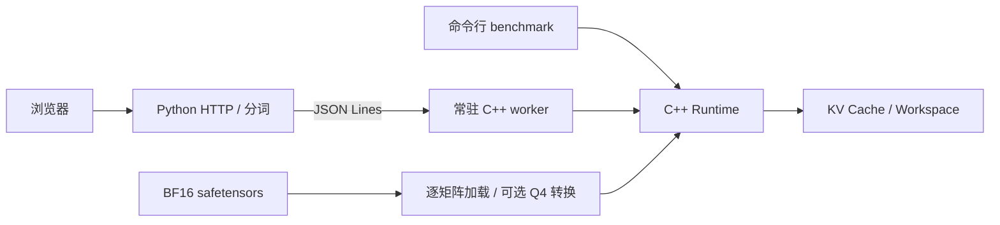

# Qwen Runtime

使用 **C++17 自主实现的 CPU 大语言模型推理引擎**，当前支持 **Qwen2.5-0.5B Base** 的单序列文本生成。模型前向、KV Cache、低比特量化与矩阵向量算子均在 C++ 中实现，不依赖 PyTorch、Transformers 或第三方推理引擎执行前向计算。

项目重点是完整推理链路、清晰的数据布局，以及有原始数据支撑的性能优化。提供命令行基准程序和本地网页演示。

## 项目亮点

- **完整模型实现**：解析 safetensors 中的 BF16 权重，完成 Embedding、RMSNorm、RoPE、GQA、SwiGLU、残差连接、KV Cache 和 greedy 生成。
- **直接计算的 Q4 Linear**：自定义 32 权重分块格式，前后半块配对打包；推理时读取量化块计算，不生成完整反量化矩阵。FP32 / Q4 通过统一 Linear 接口分派。
- **CPU 并行与向量化**：Linear 按输出行使用 OpenMP 并行；FP32 点积支持可选 AVX2 目标下的 256 位 SIMD，并保留标量路径。
- **缓冲区复用与逐矩阵加载**：预分配 KV 和 Workspace；Q4 加载逐矩阵转换，释放临时 FP32 数据，避免保留全部层的 FP32 副本。
- **算子验证与性能对照**：区分量化损失和内核计算误差，保留线程数、SIMD 开关、FP32 / Q4 三组消融实验。
- **常驻推理服务**：C++ 进程只加载一次模型，Python 负责分词和 HTTP，通过 JSON Lines 协议连接网页。

## 已记录的性能

Intel Core Ultra 7 255HX，Windows x64，MSVC Release，Qwen2.5-0.5B Base。输入 5 个 token，生成上限 16 个 token，每组预热一次、测量三次；以下为中位数。

| 对照实验 | 基线 | 优化后 | 实测加速 |
|---|---:|---:|---:|
| OpenMP：FP32，1 → 16 线程 | 238.242 ms/token | 51.636 ms/token | 4.61× |
| SIMD 开关：FP32，1 线程 | 250.725 ms/token | 94.892 ms/token | 2.64× |
| FP32 → Q4：16 线程，AVX2=ON | 50.508 ms/token | 23.623 ms/token | 2.14× |

Q4 对照中，Prefill 中位数由 **218.180 ms 降至 70.496 ms（约 3.09×）**；Decode forward 对应吞吐由 **19.799 提升至 42.331 token/s**。

这些是不同实验组的独立比较，不能相乘。Decode 只计实际 forward，不包含分词、greedy 扫描、加载或量化；本组生成 16 个 token 对应 15 次 decode forward。结果不代表 HTTP 端到端吞吐或长上下文性能。完整条件、原始样本和质量限制见[基准记录](docs/benchmarks.md)。

## 当前支持范围

| 项目 | 支持情况 |
|---|---|
| 模型 | Qwen2.5-0.5B Base；24 层、H=896、14 个 Q 头 / 2 个 KV 头 |
| 权重 | BF16 safetensors 输入；层内七个投影选择 FP32 或自定义 Q4 |
| 保留 FP32 的部分 | Norm、bias、Embedding 与共享输出投影 |
| 执行 | CPU、batch size 1、逐 token Prefill 与 Decode |
| 上下文 | 当前入口分配 512-token KV 容量 |
| 输出策略 | Greedy；达到 EOS、生成上限或容量边界时停止 |
| 接口 | 命令行、常驻 C++ worker、Python HTTP 服务、本地网页 |

网页是 Base 模型的**单轮文本续写演示**，显示记录不作为多轮上下文。当前未实现 GPU 推理、VLM、Qwen3 / Qwen3.5、流式输出或跨请求前缀复用。

## 构建与运行

依赖：Windows x64、MSVC C++ 工具链、CMake 3.20+、OpenMP。`nlohmann/json` 单头文件已包含在 `third_party/`。Python 的 `tokenizers` 用于文本与 token IDs 转换；网页额外依赖 FastAPI 和 Uvicorn。

已使用的构建环境为 Visual Studio 2026 Build Tools / MSVC 19.51、CMake 4.2.3。当前主要验证 Windows / MSVC 路径。

1. 从 [Qwen/Qwen2.5-0.5B](https://huggingface.co/Qwen/Qwen2.5-0.5B) 下载 `config.json`、`model.safetensors` 和 `tokenizer.json`，放入 `models/Qwen2.5-0.5B/`。权重不包含在仓库中。
2. 当前两个 C++ 入口仍使用固定的项目根路径。首次使用时，将 [src/main.cpp](src/main.cpp) 和 [src/chat_main.cpp](src/chat_main.cpp) 中的 `project_root` 改为自己的仓库绝对路径；包含中文时保留宽字符串写法，例如 `L"D:/projects/Qwen_runtime"`。Python 脚本按脚本位置定位仓库。
3. 在项目根目录构建并运行：

```powershell
cmake -S . -B build -DQWEN_ENABLE_AVX2=OFF
cmake --build build --config Release --target qwen_runtime qwen_chat q4_check
.\build\Release\qwen_runtime.exe 16 q4
```

`qwen_runtime` 的参数为：

```text
qwen_runtime.exe [threads] [fp32|q4] [max_new_tokens] [input_ids_path]
默认值：            4        fp32          16          data/prompt_ids.json
```

相对输入路径按 `project_root` 解释。程序加载模型、预热一次，再测量三次，保存最后一次生成的 IDs。Q4 在每次进程启动时量化一次，不使用权重磁盘缓存。

启用 FP32 SIMD 时，重新配置 `-DQWEN_ENABLE_AVX2=ON` 并构建；要求 CPU / 系统支持 AVX2。这是编译期选择，尚无运行时指令集分派。Q4 没有手写 SIMD 内核，保留普通 C++ 块点积和 OpenMP。

文本编码与结果解码：

```powershell
python -m pip install tokenizers==0.22.1
python tools/tokenizer_bridge.py encode data/prompt.txt data/prompt_ids.json
.\build\Release\qwen_runtime.exe 16 q4 16 data/prompt_ids.json
python tools/tokenizer_bridge.py decode data/generated_prompt_ids_q4_16.json data/generated_q4.txt
```

`data/story.txt` / `story_ids.json` 提供 75-token 的较长输入，可使用 `16 q4 128 data/story_ids.json` 运行。

## 本地网页演示

先完成上述 `qwen_chat` 构建、根路径配置和模型准备，再运行：

```powershell
python -m pip install tokenizers==0.22.1 fastapi uvicorn
python tools/chat_server.py
```

打开 [http://127.0.0.1:8000/](http://127.0.0.1:8000/)。服务启动一个 16 线程、Q4 模式的 C++ worker，复用模型与分词器；请求串行访问 worker，返回完整新增文本、token 计数和 forward 时间。当前只监听本机，未作为公网服务设计。

网页支持输出长度、等待与错误状态、清空显示和输入法组合输入处理。HTTP 整段响应耗时与引擎 Prefill / Decode 计时是不同指标。

## 架构与验证



| 路径 | 内容 |
|---|---|
| `include/`、`src/` | 数据结构、权重读取、算子、模型前向及生成入口 |
| `tools/q4_check.cpp` | 打包布局、量化 / 反量化与 Q4 Linear 集中验证 |
| `tools/tokenizer_bridge.py` | 文本与 token IDs 桥接 |
| `tools/chat_server.py`、`tools/index.html` | 本地服务和网页 |
| `data/` | 小型演示输入与固定 IDs |
| `docs/` | 公开技术说明、基准和验证结果 |

运行已实现的 Q4 验证：

```powershell
.\build\Release\q4_check.exe
```

已知矩阵与第 0 层 Q 投影 / FFN down 投影检查通过。Q4 内核与反量化 FP32 参考的最大绝对误差分别为 `1.907349e-6`、`3.576279e-7`；这验证所测输入下的内核实现，不等于完整模型质量对齐。

- [数据布局与执行流程](docs/architecture.md)
- [性能条件与原始样本](docs/benchmarks.md)
- [Q4 验证方法与结果](docs/validation.md)
- [版本记录](CHANGELOG.md)

## 已知限制与后续方向

当前是单一模型架构的原型实现，尚未完成独立参考框架的全模型数值对齐或系统性质量评估。75-token 故事输入的 128-token 续写中，Q4 出现连续重复，FP32 本次没有相同的重复模式；具体成因尚未定位。三次短输入计时也不足以判断尾延迟。

后续方向包括共享词表压缩、分块 Prefill，以及更大文本模型 / VLM 的架构适配。这些属于规划，不计入当前功能和性能结果。

## 第三方与模型

JSON 解析使用 [nlohmann/json](https://github.com/nlohmann/json)，保留原文件的版权和许可标记。模型与分词器来自 [Qwen2.5-0.5B](https://huggingface.co/Qwen/Qwen2.5-0.5B)，下载和使用遵循上游许可。仓库不包含模型权重、生成产物或本地开发记录。
